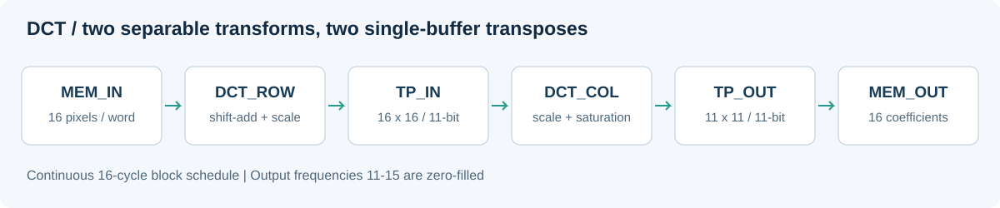
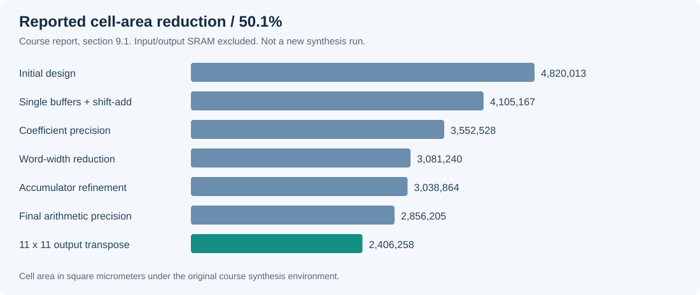

# 16 × 16 고정소수점 2D-DCT

**이현욱 | 고려대학교 전기전자공학부 | VLSI 개인 프로젝트**

[English](README.md) · [RTL](rtl/) · [보고서](reports/course-report.pdf) · [검증·재현 조건](docs/reproducibility.md)

512 × 512 영상을 16 × 16 블록으로 나누어 처리하는 2D-DCT를 Verilog로 구현했습니다. 영상 품질과 타이밍 제약을 유지하면서 연산 회로와 전치 버퍼의 면적을 줄이는 것이 목표였습니다.

## 직접 수행한 내용

- 고정 계수 곱셈을 shift-add로 구현하고 3v·5v·9v 공통 부분식을 공유했습니다.
- 입력·출력 전치 버퍼를 총 4개에서 2개로 줄이는 단일버퍼 구조를 구현했습니다.
- 고주파 계수 제거에 맞춰 출력측 버퍼를 16 × 16에서 11 × 11로 줄였습니다.
- 계수 정밀도·내부 비트폭과 PSNR의 관계를 분석하고 AC 계수에 포화 처리를 적용했습니다.
- RTL, 시뮬레이션 설정, 합성 결과 분석 및 보고서를 개인 과제로 작성했습니다.

## 보고서에 기록된 결과

| 항목 | 결과 |
| :--- | ---: |
| 합성 셀 면적 | 4,820,013 → 2,406,258 µm² |
| 초기 대비 면적 감소 | **50.1%** |
| 타이밍 제약 | **80 MHz / 12.5 ns**, slack 0.00 ns |
| 평가 영상 8개의 최저 PSNR | **29.16 dB** |

위 수치는 당시 수업 보고서 기준이며 이번 정리 과정에서 새로 합성하거나 PSNR을 측정한 결과는 아닙니다. 입력·출력 SRAM은 합성 면적에서 제외됩니다. 16 × 16 변환을 사용하는 교육용 프로젝트로, 완성된 JPEG 인코더는 아닙니다.

## 파일 구성과 확인 범위

`rtl/`은 설계 코드, `sim/`은 원본 테스트벤치와 메모리 모델, `synth/`는 합성용 SRAM stub, `reports/`는 학번을 제거한 보고서입니다. 제출 RTL을 그대로 보존했습니다.

독립 저장소의 시뮬레이션·합성 소스 구성을 컴파일하는 스크립트는 `tools/compile.py`에 있습니다. 원래 평가 영상과 MATLAB 평가 스크립트는 포함되어 있지 않아 PSNR 전체 재현에는 추가 자료가 필요합니다.

[행렬곱 프로젝트](https://github.com/hyvnwook/64x64-matrix-multiplier) · [프로필](https://github.com/hyvnwook) · [연락처](mailto:work.hyunwook@gmail.com)
