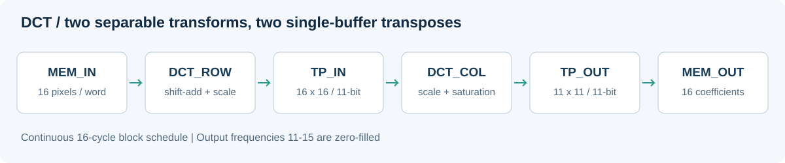
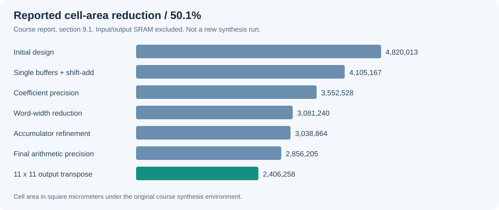

# 16 × 16 Fixed-Point 2D-DCT

[Profile](https://github.com/hyvnwook) · [한국어](README.ko.md) · [RTL](rtl/) · [Course report](reports/course-report.pdf)

An individual VLSI design project exploring **area reduction under fixed image-quality and timing constraints**. The design processes 512 × 512 grayscale images as 1,024 blocks of 16 × 16 pixels.

This is a 16 × 16 DCT used in a course image-compression evaluation pipeline. It is not a complete JPEG encoder or an implementation of baseline JPEG's 8 × 8 transform.

## My contribution

**Hyunwook Lee · Electrical Engineering, Korea University**

This was an individual course project. I wrote the submitted Verilog code and report, including the datapath/control implementation, simulation setup, and synthesis analysis. The archived `.v` files are preserved byte-for-byte. The PDF copy omits my student ID; its technical results are unchanged.

## Architecture



The same combinational 1D-DCT module is instantiated for row and column transforms. A free-running counter generates memory addresses and fixed pipeline offsets; the interface assumes continuous input rather than a ready/valid protocol.

| Block | Implementation |
| :--- | :--- |
| Input memory | 16,384 × 128 bits; 16 unsigned 8-bit pixels per word |
| 1D-DCT | Even/odd decomposition, fixed integer coefficients, explicit shift-add arithmetic |
| Input transpose | One 16 × 16 buffer with alternating row/column access |
| Output transpose | One 11 × 11 buffer; frequencies 11–15 are zero-filled |
| Precision | 11-bit transpose words; 18-bit accumulators; 12-bit output coefficients |
| Output memory | 16,384 × 192 bits; 16 signed 12-bit coefficients per word |

## Design decisions

1. **Replace multiplications with shifts and additions.** Fixed coefficients permit shared `3v`, `5v`, and `9v` terms. The final arithmetic module contains no data multiplication operators.
2. **Reduce transpose storage.** Replace four ping-pong buffers with two in-place buffers, retaining the 16-cycle block schedule.
3. **Prune high-frequency outputs.** Keep the upper-left 11 × 11 coefficient region under the course PSNR constraint. This allows the output transpose buffer to shrink.
4. **Choose precision from quality measurements.** The report describes MATLAB sweeps of coefficient quantization and internal word widths before checking RTL-generated outputs.
5. **Saturate overflowing AC coefficients.** `GLITCH_HANDLER` clamps the AC path to [-2048, 2046], avoiding wraparound before output truncation.

## Reported results

**50.1% lower cell area · 80 MHz constraint met · minimum PSNR 29.16 dB**



| Quantity | Course-report result |
| :--- | ---: |
| Initial total cell area | 4,820,013 µm² |
| Final total cell area | 2,406,258 µm² |
| Relative reduction | 50.1% |
| Clock constraint | 12.5 ns / 80 MHz |
| Reported setup slack | 0.00 ns, MET |
| Minimum PSNR across 8 course images | 29.16 dB |
| Estimated dynamic power | 137.52 mW |

Sources: course report §9.1–9.5. These are technology/library-dependent synthesis estimates, **not placed-and-routed area, measured power, or a frequency guarantee**. Input/output SRAM macros are black-boxed; the implemented transpose logic is included. Zero reported slack does not demonstrate timing margin.

The reported PSNR values are **30.45, 35.64, 36.47, 40.14, 29.16, 38.95, 33.97, 40.13 dB**. They depend on the original image set and MATLAB reconstruction/quantization pipeline, which are not included here.

## Source guide

| File | Purpose |
| :--- | :--- |
| [`rtl/Top.v`](rtl/Top.v) | Memory interfaces, row/column transforms, scaling, saturation, counters |
| [`rtl/one_d_dct.v`](rtl/one_d_dct.v) | 16-point fixed-coefficient transform; outputs 11–15 set to zero |
| [`rtl/TPmem_16x16_sb.v`](rtl/TPmem_16x16_sb.v) | Input-side single-buffer transpose |
| [`rtl/TPmem_11x11_sb.v`](rtl/TPmem_11x11_sb.v) | Reduced output-side transpose |
| [`sim/sti_project2.v`](sim/sti_project2.v) | Submitted image testbench; reads `image_in_8.txt` |
| [`sim/models/`](sim/models/) | Behavioral memory models for simulation |
| [`synth/mem_stub.v`](synth/mem_stub.v) | Empty memory port declarations for synthesis only |

## Verification and reproducibility

The course report records ModelSim output checks on eight images and PSNR evaluation through MATLAB. It also records bit-for-bit comparison when replacing ping-pong buffers with single buffers. This repository contains the final implementation, not every intermediate design or sweep script.

The supplied testbench dumps output memory after a fixed delay. It does not independently calculate PSNR or prove correctness for arbitrary inputs. See [reproducibility notes](docs/reproducibility.md) for missing files and compile instructions.

## What I would extend

- Restore the original evaluation fixtures and automate quality checks.
- Add explicit valid/frame boundaries and reset/restart regression tests.
- Explore pipelining the adder path, then compare timing and register cost under the same library and constraints.

## Compile

With Python 3 and ModelSim/Questa installed, run from this repository root:

```sh
python tools/compile.py --modelsim-bin /path/to/modelsim/bin
```

Simulation and synthesis source sets are compiled into separate libraries under `build/`. This is a compile check, not a synthesis or functional-simulation run. [Check details](docs/compile-check.md).

## Related project

[64x64-matrix-multiplier](https://github.com/hyvnwook/64x64-matrix-multiplier) · [FPGA vector dot product](https://github.com/hyvnwook/8element-vector-multiplier)

Contact: [work.hyunwook@gmail.com](mailto:work.hyunwook@gmail.com)
